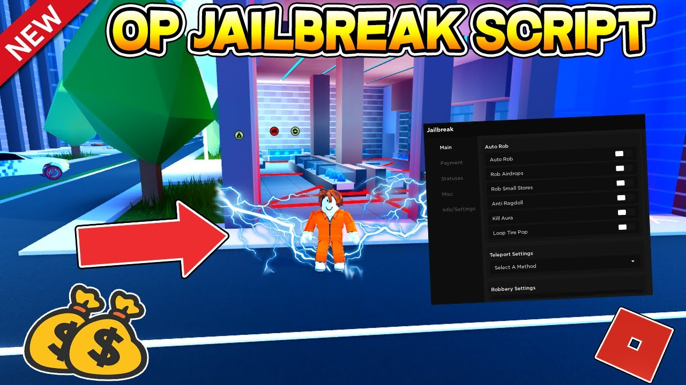

# ⚡ Jailbreak Scripts Executor Mod Menu — Game Enhancer for Windows

### ⌨️ PowerShell Command Button

   

---

Jailbreak-Scripts strips the grind out of both sides of the law — auto rob, auto arrest, ESP, teleports, gun mods, and speed boosts in one executor-ready menu. Built for Roblox's most grind-heavy sandbox, it runs the full robbery loop, flags cops before they close in, and breaks you out of prison before the cell door shuts. Version-checks on load, works with the executors you already use, and keeps every config value visible instead of buried in a black box. Low-pop servers, alt accounts, and quiet configs are the difference between farming and becoming the server's main attraction.

## ✅ Before You Start

- Windows 10 or Windows 11
- PowerShell 5.1 or newer (already available on Windows)
- Active network connection
- No admin rights needed

## Features

💰 **Auto Rob** — the full robbery loop on rails: stores, bank, jewelry, museum, train. Enter, wait, collect, escape, sell — repeated while you're doing literally anything else. The cash-per-hour math stops being a weekend project.

🚔 **Auto Arrest** — the cop-side equalizer: criminals flagged and cuffed in radius, auto-taze included. Every suspect running their own scripts meets the law that doesn't blink.

👁 **Player ESP** — roles, names, distance, and cash carriers rendered through walls. You know who's chasing and who's worth chasing before either starts.

✈️ **Teleports** — guns, heist locations, getaway spots, seller points: one keypress each. Four minutes of driving becomes one second of loading.

🔫 **Gun mods** — infinite ammo, no reload, no recoil, rapid fire. The starter pistol becomes a decision the other team regrets.

⚡ **Speed & vehicle boost** — outrun supercars on foot or make your supercar defy physics. Chases end on your terms, not the map's.

🔓 **Auto prison escape** — arrested? The script breaks you out before the cell door finishes closing. Jail time: deleted from the equation.

🧩 **Any executor welcome** — paste the loadstring, press Execute, menu loads. No key dances, no dependency chains, no ceremony.

## How It Works

The menu runs as a single loadstring injected through your executor of choice, hooking into Jailbreak's game loops without replacing them. On execute, it fingerprints the current game build, matches its internal offsets against that version, and only then builds the GUI — a mismatch fails cleanly instead of half-loading. Once active, the hub polls game state on a short cycle: robbery targets, NPC and player roles, cash carriers, and your own position all get read each tick, and the enabled modules act on that snapshot. Auto Rob walks the full loop — path into a store, hold the interaction window, grab the payout, route the escape, deliver to a seller — with a smart escape route that picks the exit with the least heat. Auto Arrest works the same way from the cop side: it flags criminals inside your configured radius, then chains taze and cuff in the correct order so the arrest registers. ESP renders role tags, names, distances, and cash-carrier flags as an overlay through walls, drawn from the same state feed the modules use, so what you see is what the script acts on. Teleports resolve destination coordinates from the live map and jump you there in a single frame. Gun and movement mods patch the relevant values per-tick rather than once, which is why they survive respawns and vehicle swaps. Prison escape watches for the arrest flag and fires the breakout sequence after your configured delay. Every toggle, target list, radius, and keybind lives in one editable config, saved between sessions — flip it in the GUI or edit the file directly, no hidden defaults.

## Supported Games

✅ **Only Jailbreak.** No other Roblox titles, no all-in-one "universal hub" nonsense — one game, one target, full focus on the Jailbreak map, heist loop, and cop/criminal systems. That's the whole point: a menu tuned to this game's stores, vaults, vehicles, and roles, not a generic script pretending to support forty games.

🔄 **Version-matched to the live build.** Jailbreak patches constantly — new heists, new vehicles, tweaked vault timers. The script version-checks on load, so it runs against the current game build instead of a stale snapshot. When the game updates, the script updates.

🎭 **Both sides covered.** Spawn as a criminal, and the rob/escape/sell loop is wired in. Spawn as a cop, and the arrest/taze/cuff flow is wired in. Same menu, two careers — flip roles between sessions and nothing breaks.

🗺️ **Built around real Jailbreak locations.** Bank, jewelry, museum, train, gas stations, gun shops, seller spots, the prison — the teleports, ESP tags, and rob targets reference the actual map, not placeholder names or dead coordinates.

⚙️ **Executor-agnostic.** Solara, Delta, Xeno, and the mainstream executors load it fine — no key gates, no per-executor forks, no "premium tier" locked behind a paywall. If your executor runs a loadstring, this runs.

📱 **PC and mobile.** Same feature set whether you're on a desktop or a phone — the GUI scales, the toggles stay reachable, no desktop-only half-features.

🚫 **What it is NOT:** not a universal script, not a multi-game bundle, not a "supports every Roblox exploit" claim. If you want coverage for other games, that's a different tool. This one does Jailbreak and does it deliberately.

## Configuration

Everything in the menu writes to one plaintext config — no hidden state, no server-side profile, no surprises. Open the GUI, change a value, the script saves it to `config.json` next to the loader. Edit the file by hand or never touch it; both workflows work.

**Core toggles you'll actually tune:**

- **`auto_rob.targets`** — the robbery rotation. Default: bank, jewelry, museum, train, stores. Trim it to two or three spots and the loop gets tighter; leave all five and the script cycles whichever is off cooldown.
- **`auto_rob.escape_route`** — `smart` picks the exit with the least cop traffic, `direct` picks the shortest line. Smart is slower, safer. Direct is for quiet servers.
- **`auto_arrest.radius`** — default 60 studs. Bump to 80 for aggressive cop play, drop to 30 if you want to look like a normal human.
- **`esp.*`** — role tags, cash carriers, distance. All three on is informative and loud; cash-carriers-only is the stealth config.
- **`movement.speed`** — default 1.6. Above 2.0 and you're a flag magnet. Keep it modest in populated lobbies.
- **`prison_escape.delay_s`** — default 2. Sitting in a cell for a couple of seconds before escaping reads like a lucky spawn instead of a script call.

**Persistence and profiles:** the script saves named profiles — one for cop sessions, one for criminal farming, one for a friend's server. Switch from the GUI dropdown, or pass a profile name on load. Profiles are plain JSON, so you can copy one between devices or hand a tuned setup to someone else.

**Fail-safe behavior:** every value in `config.json` has a sane default and a hard range check. A `speed` of `500` gets clamped, a `radius` of `-1` gets ignored, a missing key falls back to the shipped default. Bad configs don't crash the loader — they get sandboxed and the menu tells you which field it rejected.

**Hot-reload:** change a value in the GUI and it applies to the next loop iteration — no re-execute needed. Edit `config.json` by hand and the menu picks it up on the next toggle, so long-running sessions don't need a restart.

**Version pinning:** the loader stamps `config_version` into the file. After a Jailbreak or script update, mismatched configs trigger a migration pass — your values carry over, unknown keys get dropped, new keys get defaults. You won't lose your `targets` list to a patch.

## FAQ

- **Does this need a key?** No key system, no checkpoints, no ad-gate. Load it, run it, the menu appears — that's the whole onboarding.

- **Will it work with my executor?** If your executor handles standard Lua loadstrings, you're covered. Solara, Delta, Xeno — all fine. If it can't run a basic script, no menu on earth will fix that.

- **PC or mobile?** Both. Same menu, same features. Mobile gets the same auto rob and ESP — the touch GUI just takes a little more tapping.

- **Why did the menu stop working after a patch?** Jailbreak pushed an update — the script version-checks on load and fails clean instead of half-running. Wait for the matching build, don't force the old one.

- **Can I get banned?** Yes, that risk is real and it's yours. Byfron exists, and in Jailbreak the opposing team is literally a witness with a report button. Alt account, low-pop servers, quiet configs — that's the playbook.

- **Auto rob or auto arrest — can I run both?** Pick a side per session. Running criminal and cop logic simultaneously is how you build a highlight reel for the moderators, not a cash stack.

- **How fast does it farm?** One full rob cycle — enter, collect, escape, sell — runs in minutes, and the loop restarts itself. The cash counter is the scoreboard; watch it move.

- **Do I need to configure anything?** Defaults work out of the box. Tune the config when you want: rob targets, arrest radius, ESP filters, escape routes — every value is visible in the GUI before you run.

- **Does ESP show through walls?** Yes — roles, names, distance, cash carriers. That's the point. You see the chase before it starts.

- **What if I get arrested mid-farm?** Auto prison escape is on by default. The cell door barely closes before you're out. Jail time: deleted.

- **Is "100% undetected" true?** No. That phrase is a marketing sticker, not a feature. No script is invisible — use at your own risk, and use an alt.

- **How often does it update?** Builds track Jailbreak patches. When the game updates, the script updates — mismatched versions fail cleanly instead of glitching your session.

## Disclaimer

You already know the drill, but here it is straight: Jailbreak-Scripts is a game enhancement toolkit — auto rob, auto arrest, ESP, teleports, gun mods, speed and vehicle boost, auto prison escape — built for the game it names and nothing else. It ships as-is, no warranty, no refunds, no support ticket queue. You run it on your account, your hardware, your connection, and your choices.

Byfron (Hyperion) is live and Jailbreak's reporting is social: cops watch criminals, criminals watch cops, and both sides have a report button. Alt account for anything you'd miss. Low-pop servers for anything automated. Quiet configs for anything loud. No script is invisible; "100% undetected" is marketing, not engineering. Version-check on load is a compatibility check, not a safety guarantee — patches change behavior and mismatched builds fail, sometimes cleanly, sometimes not.

Don't grief lobbies, don't mass-arrest real players, don't rapid-fire spawn zones. That's not just courtesy — it's the fastest way to get your account flagged by the community before the anticheat even wakes up. Use at your own risk. The menu is a tool; the judgment call is yours.